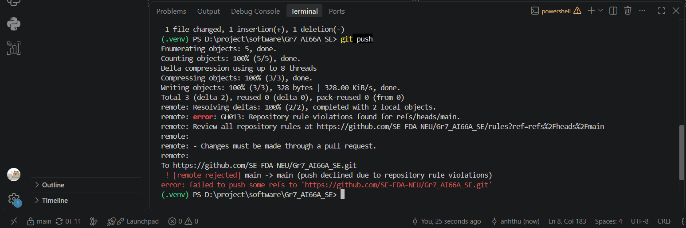

# Operations

## 1 How to run and release

Live app: [minilms-nhom7.onrender.com](https://minilms-nhom7.onrender.com), a Render Python web service on the Free plan, deployed from `main`. Merge a reviewed PR to `main`; after CI passes, Render automatically deploys. Confirm the deploy is Live and check `/health`.

To roll back a merged change, create a branch from `main`, run `git revert -m 1 <merge-commit>` for the merge commit, open a PR, wait for green CI, then merge it; Render deploys the reverted version automatically.

Issue [#158](https://github.com/SE-FDA-NEU/Gr7_AI66A_SE/issues/158) records one measured deployment: PR #169 merged at 15:40 and Render showed Live at 15:41 (about 1 minute). A separate 5-minute merge-click-to-updated-server duration was reported for this task; exact t1/t2 clock times, date, and timezone were not supplied (**TODO: record them and confirm the Thursday trial**). Do not treat these as the same run.

## 2 The CI pipeline

The workflow runs on pushes and PRs targeting `main` or `develop`.

| Step | What it checks or does |
|---|---|
| Checkout repository | Checks out the commit being tested. |
| Set up Python | Installs Python 3.11 and enables pip dependency caching. |
| Install dependencies | Upgrades pip and installs `requirements.txt`. |
| Run tests with pytest | Runs `pytest --cov=src tests/` with the repository on `PYTHONPATH`; collects coverage for `src`. |

Latest successful run on `main`: [CI Pipeline #43424034123](https://github.com/SE-FDA-NEU/Gr7_AI66A_SE/actions/runs/43424034123), **1m 07s** in Actions.

## 3 Monitoring

Each request writes a JSON log to stdout with method, route-template path, status code, and duration in milliseconds. Server exceptions log filtered stack-frame locations, not exception messages. Read these entries in Render → Logs. The app does not log passwords, email addresses, quiz answers, request bodies, cookies, or raw URLs.

`/health` opens SQLite read-only and queries the `user` table. It returns 200 when the query succeeds and 503 when the database is unavailable; it does not check every application feature.

Track the **5xx error rate** (5xx responses divided by all requests) and **response time** (`duration_ms`, summarized as p95) from request logs. Treat a sustained rise in either versus its recent baseline as deterioration; no numeric alert threshold is configured. The Render Free plan provides only basic Render notifications; this app has no custom alerting.

**TODO before review:** Add verified live-check results from [#159](https://github.com/SE-FDA-NEU/Gr7_AI66A_SE/issues/159); that issue currently has no execution results. Record the exact date, timezone, and t1/t2 clock times for the reported 5-minute run and confirm it was the Thursday trial.
