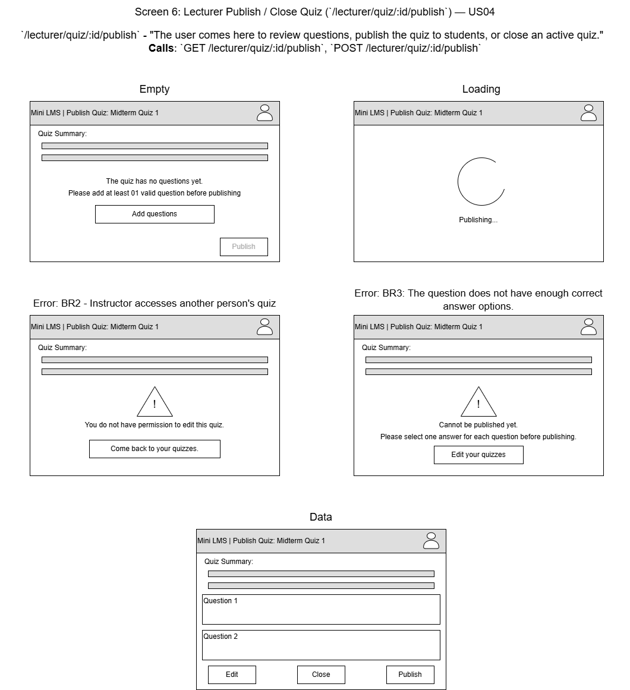

# Mini LMS — User Interface (Milestone 3)

Tài liệu thiết kế và đặc tả giao diện người dùng của hệ thống Mini LMS phục vụ Milestone 3 (Sprint 3).  
Tài liệu tập trung vào các User Story P0, luồng màn hình điều hướng không cần gõ URL thủ công, hệ thống thông báo lỗi nghiệp vụ thân thiện và các thay đổi kiến trúc/API so với Milestone 2.

---

## 1. P0 stories and status

Bảng tổng hợp 6 User Story cốt lõi (P0) cùng màn hình hỗ trợ `/lecturer/dashboard` trong Sprint 3. Mọi tính năng được nghiệm thu theo tiêu chí: người dùng có thể thực hiện trọn vẹn quy trình nghiệp vụ chỉ bằng cách bấm nút trên giao diện (không gõ URL thủ công) và nhận được thông báo rõ ràng khi vi phạm Business Rules (BR1–BR6).

### 1.1 Bảng theo dõi trạng thái P0 Stories

| Story ID | Story Title & Persona | Screen(s) | Route(s) | Status | Issue | Ghi chú nghiệm thu / PR |
| :--- | :--- | :--- | :--- | :---: | :---: | :--- |
| **US01** | Sign in and receive the correct role *(Lecturer / Student)* | Màn hình Đăng nhập (Sign In) | `GET /login`<br>`POST /login`<br>`POST /logout` | **`works`** | [#17](https://github.com/SE-FDA-NEU/Gr7_AI66A_SE/issues/17) / [#92](https://github.com/SE-FDA-NEU/Gr7_AI66A_SE/issues/92) | Đã merge PR #93. Điều hướng đúng dashboard theo role (`lecturer` / `student`); khóa tài khoản 15 phút sau 5 lần sai mật khẩu (BR1); nút Đăng xuất xóa session sạch sẽ. |
| **US02** | Lecturer creates a quiz *(Lecturer)* | Form tạo quiz mới & Dashboard Giảng viên | `POST /quiz/create`<br>`GET /lecturer/dashboard` | **`works`** | [#18](https://github.com/SE-FDA-NEU/Gr7_AI66A_SE/issues/18) | Tạo quiz với tiêu đề, thời lượng (phút), trạng thái khởi tạo `draft`. Kiểm tra validation bắt buộc tiêu đề; tự chuyển hướng sang thêm câu hỏi. |
| **US03** | Lecturer adds multiple-choice questions *(Lecturer)* | Quản lý câu hỏi & phương án trả lời | `POST /quiz/:id/questions` | **`works`** | [#19](https://github.com/SE-FDA-NEU/Gr7_AI66A_SE/issues/19) | Thêm câu hỏi với các lựa chọn (ít nhất 2 choices), chọn 1 đáp án đúng duy nhất. Có nút chuyển tiếp sang trang Publish. |
| **US04** | Lecturer publishes and closes a quiz *(Lecturer)* | Màn hình Publish & Đóng bài Quiz | `GET /lecturer/quiz/:id/publish`<br>`POST /lecturer/quiz/:id/publish`<br>`POST /lecturer/quiz/:id/close` | **`works`** | [#34](https://github.com/SE-FDA-NEU/Gr7_AI66A_SE/issues/34) / [#89](https://github.com/SE-FDA-NEU/Gr7_AI66A_SE/issues/89) | Đã hoàn thiện qua PR #89 (branch `89-us04-publish-quiz`). Chặn giảng viên khác (BR2); kiểm tra quiz đủ điều kiện ≥ 1 câu hỏi, đủ đáp án đúng (BR3); đóng quiz ngăn sinh viên làm bài (BR4). |
| **US06** | Student starts a quiz attempt *(Student)* | Dashboard Sinh viên & Giao diện làm bài (có Timer) | `GET /student/dashboard`<br>`POST /student/quiz/:id/start`<br>`GET /student/quiz/:id/take`<br>`POST /student/quiz/:id/take` | **`works`** | [#30](https://github.com/SE-FDA-NEU/Gr7_AI66A_SE/issues/30) / [#88](https://github.com/SE-FDA-NEU/Gr7_AI66A_SE/issues/88) | Đã merge PR #94. Bắt đầu hoặc tiếp tục attempt đang mở; hiển thị từng câu hỏi kèm bộ đếm ngược; lưu câu trả lời bằng kỹ thuật Post/Redirect/Get; chặn quiz đóng (BR4) hoặc đã nộp (BR5). |
| **US08** | Student submits a quiz *(Student)* | Màn hình xác nhận nộp & tổng kết | `POST /student/quiz/:id/submit` | **`works`** | [#31](https://github.com/SE-FDA-NEU/Gr7_AI66A_SE/issues/31) | Tự động chấm điểm từ đáp án đã lưu; ghi nhận đúng 1 mốc thời gian nộp bài (`submitted_at`); từ chối nộp lần 2 hoặc can thiệp sau nộp (BR5, BR6). |
| *(US14)* | Lecturer sees their quizzes on a dashboard *(Màn hình điều hướng)* | Lecturer Dashboard | `GET /lecturer/dashboard` | **`works`** | [#49](https://github.com/SE-FDA-NEU/Gr7_AI66A_SE/issues/49) | Hiển thị danh sách quiz của chính giảng viên (BR2), trạng thái (Draft, Published, Closed), số lượt attempt; cung cấp nút Tạo Quiz và Publish trực tiếp. |

*Ghi chú quy ước trạng thái:*
- `works`: Đã hoàn thành, tích hợp giao diện với SQLite backend, đi hết luồng bằng nút bấm và vượt qua toàn bộ unit/integration tests tự động.
- `partly works`: Đang xử lý giao diện hoặc thiếu một phần xác thực validation.
- `not started`: Chưa bắt đầu triển khai code.

---

### 1.2 Sơ đồ điều hướng màn hình (Updated Screen Flow)

Sơ đồ điều hướng cập nhật từ Milestone 1 nhằm phản ánh chính xác luồng thao tác thực tế trong Milestone 3:
1. **`/login` là cổng vào duy nhất:** Phân luồng người dùng dựa trên role sau khi đăng nhập thành công.
2. **Loại bỏ việc gõ URL thủ công:** Mọi màn hình P0 đều được liên kết mạch lạc qua các nút hành động (Button/Link).
3. **Cập nhật `/lecturer/dashboard`:** Đóng vai trò trạm điều hướng trung tâm của Giảng viên để kết nối US02 (Tạo quiz), US03 (Thêm câu hỏi) và US04 (Publish/Close quiz).

```mermaid
flowchart TD
    classDef startNode fill:#e0f2fe,stroke:#0284c7,stroke-width:2px;
    classDef lecturerNode fill:#fef3c7,stroke:#d97706,stroke-width:2px;
    classDef studentNode fill:#dcfce7,stroke:#16a34a,stroke-width:2px;
    classDef actionNode fill:#f1f5f9,stroke:#64748b,stroke-width:1px;

    Login["/login<br>(US01 - Đăng nhập)"]:::startNode

    subgraph LecturerFlow["Luồng Giảng viên (P0 End-to-End)"]
        LDash["/lecturer/dashboard<br>(US14 - Danh sách Quiz của tôi)"]:::lecturerNode
        Create["/quiz/create<br>(US02 - Tạo Quiz mới)"]:::lecturerNode
        Questions["/quiz/:id/questions<br>(US03 - Thêm câu hỏi & lựa chọn)"]:::lecturerNode
        Publish["/lecturer/quiz/:id/publish<br>(US04 - Xem lại, Publish & Đóng Quiz)"]:::lecturerNode
    end

    subgraph StudentFlow["Luồng Sinh viên (P0 End-to-End)"]
        SDash["/student/dashboard<br>(US05 - Danh sách Quiz sẵn sàng)"]:::studentNode
        Take["/student/quiz/:id/take?q=n<br>(US06 - Làm bài, Timer, Chọn đáp án)"]:::studentNode
        Submit["/student/quiz/:id/submit<br>(US08 - Xác nhận nộp & Xem kết quả)"]:::studentNode
    end

    %% Điều hướng sau khi đăng nhập
    Login -->|Role Lecturer| LDash
    Login -->|Role Student| SDash

    %% Chi tiết luồng Giảng viên
    LDash -->|Bấm 'Tạo Quiz'| Create
    Create -->|Lưu Quiz (Draft)| Questions
    Questions -->|Bấm 'Tiếp: Publish'| Publish
    Publish -->|Bấm 'Publish Quiz' / 'Close Quiz'| LDash
    LDash -->|Bấm 'Publish' hoặc 'Manage' trên bảng Quiz| Publish

    %% Chi tiết luồng Sinh viên
    SDash -->|Bấm nút 'Take quiz' (POST /start)| Take
    Take -->|Bấm 'Next / Prev / Jump' (POST /take)| Take
    Take -->|Hết giờ hoặc Bấm 'Nộp bài'| Submit
    Submit -->|Bấm 'Quay lại Dashboard'| SDash

    %% Đăng xuất từ các Dashboard
    LDash -.->|Bấm 'Sign out' (POST /logout)| Login
    SDash -.->|Bấm 'Sign out' (POST /logout)| Login
```

---

## 2. Wireframes

*(Mục này tổng hợp thiết kế khung giao diện của các màn hình P0. Mỗi màn hình mô tả mục đích người dùng, các endpoint API được gọi và hình ảnh wireframe tương ứng).*

### 2.1 Màn hình Đăng nhập — `/login` (US01)
- **The user comes here to:** Xác thực danh tính bằng email và mật khẩu, nhận phiên làm việc bảo mật (session) và tự động chuyển về Dashboard tương ứng với vai trò của mình.
- **Endpoints called:**
  - `GET /login`: Hiển thị form đăng nhập.
  - `POST /login`: Gửi thông tin `email`, `password`.
  - `POST /logout`: Hủy session đăng nhập và chuyển hướng về `/login`.

### 2.2 Màn hình Giảng viên — `/lecturer/dashboard` & `/quiz/create` (US02, US14)
- **The user comes here to:** Xem toàn bộ danh sách các bài quiz do chính mình tạo ra cùng trạng thái hiện tại (`draft`, `published`, `closed`), số lượt sinh viên đã nộp bài; tạo quiz mới và đi tiếp đến khâu soạn đề.
- **Endpoints called:**
  - `GET /lecturer/dashboard`: Lấy danh sách quiz thuộc sở hữu của giảng viên đang đăng nhập.
  - `POST /quiz/create`: Gửi thông tin `title`, `duration_minutes` để khởi tạo bản ghi quiz mới ở trạng thái `draft`.

### 2.3 Màn hình Soạn câu hỏi — `/quiz/:id/questions` (US03)
- **The user comes here to:** Thêm từng câu hỏi trắc nghiệm, tạo các phương án lựa chọn (ít nhất 2 choices), đánh dấu radio chọn duy nhất 1 đáp án đúng theo quy định BR3, và bấm nút chuyển tiếp sang duyệt Publish.
- **Endpoints called:**
  - `POST /quiz/:id/questions`: Lưu nội dung câu hỏi, điểm số, danh sách choices và chỉ số đáp án đúng.

### 2.4 Màn hình Publish và Đóng bài Quiz — `/lecturer/quiz/:id/publish` (US04)
- **The user comes here to:** Kiểm tra tổng thể nội dung bài quiz (tiêu đề, thời lượng, danh sách câu hỏi, trạng thái đáp án đúng), phát hiện các cảnh báo vi phạm BR3 trước khi chính thức bấm "Publish Quiz" để mở đề cho sinh viên, hoặc bấm "Close Quiz" để kết thúc đợt thi.
- **Endpoints called:**
  - `GET /lecturer/quiz/:id/publish`: Lấy chi tiết bài quiz và danh sách câu hỏi/đáp án kèm cờ kiểm tra tính hợp lệ `is_publishable`.
  - `POST /lecturer/quiz/:id/publish`: Chuyển trạng thái quiz từ `draft` sang `published`.
  - `POST /lecturer/quiz/:id/close`: Chuyển trạng thái quiz từ `published` sang `closed`.
- **Wireframe layout:**



### 2.5 Màn hình Dashboard Sinh viên — `/student/dashboard` (US05, US06 — 4 trạng thái)
- **The user comes here to:** Xem danh sách các bài quiz đang mở (`published`), nắm bắt thời hạn kết thúc (`end_at`), thời lượng làm bài và bấm nút bắt đầu làm bài.
- **4 trạng thái giao diện bắt buộc:**
  1. *Empty state:* Hiển thị thông báo thân thiện "No published quizzes available." khi chưa có bài thi nào được mở.
  2. *Loading state:* Hiển thị chỉ báo đang tải dữ liệu danh sách quiz từ cơ sở dữ liệu.
  3. *Error state:* Hiển thị hộp thoại lỗi kèm nút "Thử lại" khi mất kết nối mạng hoặc lỗi truy vấn database.
  4. *Data state:* Hiển thị bảng danh sách các bài quiz với đầy đủ thông tin: Tiêu đề, Giảng viên phụ trách, Thời lượng, Hạn nộp và nút bấm "Take quiz".
- **Endpoints called:**
  - `GET /student/dashboard`: Truy vấn danh sách bài thi đang publish.
  - `POST /student/quiz/:id/start`: Khởi tạo lượt thi mới hoặc tiếp tục lượt thi chưa hoàn thành của sinh viên.

### 2.6 Màn hình Làm bài thi — `/student/quiz/:id/take` & Nộp bài (US06, US08)
- **The user comes here to:** Trả lời lần lượt các câu hỏi trắc nghiệm trong thời gian giới hạn (có đồng hồ đếm ngược thời gian thực); tự động lưu câu trả lời mỗi khi chọn; duyệt lại các câu chưa làm và nộp bài.
- **Endpoints called:**
  - `GET /student/quiz/:id/take?q=n`: Hiển thị câu hỏi thứ `n` cùng các lựa chọn và thời gian còn lại.
  - `POST /student/quiz/:id/take`: Lưu lựa chọn của sinh viên vào cơ sở dữ liệu (Post/Redirect/Get).
  - `POST /student/quiz/:id/submit`: Nộp bài thi chính thức, khóa quyền chỉnh sửa và tính điểm tự động.

---

## 3. Error messages

Hệ thống Mini LMS tuân thủ nguyên tắc thiết kế thông báo lỗi thân thiện (user-friendly error handling). Một thông báo đạt chuẩn phải cung cấp đầy đủ 3 yếu tố:
1. **Chuyện gì đã xảy ra** (What happened).
2. **Vì sao xảy ra lỗi** (Why it happened — liên kết với Business Rule cụ thể).
3. **Người dùng nên làm gì tiếp theo** (What to do next — kèm nút quay lại hoặc hướng giải quyết).

Tuyệt đối không hiển thị mã lỗi thô như "Error 422", "Something went wrong" hay mã nguồn lỗi (stack trace) cho người dùng cuối.

### Bảng đối chiếu mã lỗi API, Business Rule và Thông báo hiển thị thực tế trên ứng dụng

Bảng dưới đây trích xuất chính xác từ hệ thống mã lỗi trong `src/errors.py`, module dịch vụ `quiz_service.py`, `attempt_service.py` và bảng thiết kế API trong `docs/design.md`:

| Mã lỗi API (Status) | Business Rule / Story ID | Thông báo người dùng thấy trên giao diện (User-Facing Message) | Ngữ cảnh kích hoạt lỗi & Hành động khắc phục |
| :---: | :---: | :--- | :--- |
| **`429`** | **BR1** / US01 | `"Too many failed attempts. Try again in 15 minutes."`<br>*(Tiếng Việt: "Bạn nhập sai 5 lần. Vui lòng thử lại sau 15 phút.")* | **Kích hoạt:** Người dùng nhập sai mật khẩu 5 lần liên tiếp trong vòng 10 phút trên form `/login`.<br>**Giải quyết:** Hệ thống kích hoạt bộ đếm thời gian khóa; người dùng cần đợi 15 phút trước khi thử đăng nhập lại. |
| **`403`** | **BR2** / US04 | `"Bạn không có quyền sửa quiz này vì nó thuộc giảng viên khác. Hãy quay lại danh sách quiz của bạn. (You do not have permission to edit this quiz.)"` | **Kích hoạt:** Giảng viên A cố tình truy cập hoặc gửi request POST để sửa/publish bài quiz thuộc quyền sở hữu của Giảng viên B.<br>**Giải quyết:** Ứng dụng từ chối truy cập và cung cấp nút bấm quay về Dashboard cá nhân của Giảng viên. |
| **`422`** | **BR3** / US04 | `"Chưa thể publish: bài quiz phải có ít nhất 1 câu hỏi. (A quiz must contain at least 1 question.)"` | **Kích hoạt:** Giảng viên bấm nút "Publish Quiz" cho một bài quiz chưa có bất kỳ câu hỏi nào (0 câu hỏi).<br>**Giải quyết:** Khóa nút Publish và hiển thị thông báo yêu cầu giảng viên quay lại form thêm ít nhất một câu hỏi hợp lệ. |
| **`422`** | **BR3** / US04 | `"Chưa thể publish: câu {position} chưa có đáp án đúng. Hãy chọn đúng 1 đáp án cho mỗi câu. (Please select one correct option.)"`<br>*(Ví dụ: "Chưa thể publish: câu 2 chưa có đáp án đúng. Hãy chọn đúng 1 đáp án cho mỗi câu.")* | **Kích hoạt:** Bài quiz có câu hỏi nhưng câu hỏi tại vị trí `{position}` chưa được tích chọn đáp án đúng nào trong các lựa chọn.<br>**Giải quyết:** Chỉ rõ chính xác vị trí câu bị thiếu đáp án để giảng viên vào sửa, không cần tự rà soát lại toàn bộ đề. |
| **`422`** | **BR3** / US04 | `"Chưa thể publish: câu {position} phải có ít nhất 2 đáp án lựa chọn."` | **Kích hoạt:** Câu hỏi trắc nghiệm tại vị trí `{position}` chỉ có 0 hoặc 1 phương án lựa chọn, không đủ điều kiện tạo câu hỏi trắc nghiệm.<br>**Giải quyết:** Yêu cầu giảng viên bổ sung thêm các lựa chọn cho câu hỏi đó. |
| **`403`** | **BR4** / US06 | `"This quiz is closed, so you can't start it. Contact your lecturer if you need access."`<br>*(Tiếng Việt: "Quiz đã đóng nên bạn không thể bắt đầu làm bài. Liên hệ giảng viên nếu cần.")* | **Kích hoạt:** Sinh viên cố tình bấm vào làm bài thi của một quiz đã chuyển sang trạng thái `closed`.<br>**Giải quyết:** Chặn sinh viên bắt đầu làm bài mới; hướng dẫn sinh viên liên hệ giảng viên phụ trách nếu cần gia hạn thời gian làm bài. |
| **`409`** | **BR5** / US06, US08 | `"You have already submitted this quiz, and each quiz allows only one submission. Go back to the dashboard to see other quizzes."`<br>*(Tiếng Việt: "Bạn đã nộp quiz này rồi. Mỗi quiz chỉ được nộp 1 lần; bạn có thể xem lại kết quả.")* | **Kích hoạt:** Sinh viên đã hoàn thành và nộp bài thi, nhưng sau đó cố tình mở lại link `/take` hoặc bấm nút nộp bài lần thứ 2.<br>**Giải quyết:** Chặn thao tác ghi đè kết quả; hiển thị thông báo giải thích và cung cấp link quay về Dashboard sinh viên. |
| **`400`** | **US02** | `"Quiz title is required."` | **Kích hoạt:** Giảng viên để trống trường Tiêu đề bài quiz khi bấm nút Lưu trên form `/quiz/create`.<br>**Giải quyết:** Form giữ lại các dữ liệu khác và hiển thị cảnh báo đỏ yêu cầu nhập tiêu đề bài thi. |
| **`403`** | **BR4** / US06 | `"Time is up for this quiz, so your answer was not saved. Contact your lecturer if you think this is a mistake."` | **Kích hoạt:** Sinh viên gửi câu trả lời sau khi đồng hồ đếm ngược thời gian của lượt thi đã chạm mốc 00:00.<br>**Giải quyết:** Từ chối lưu lựa chọn muộn; chuyển hướng người dùng đến màn hình tổng kết nộp bài. |
| **`400`** | **US04** | `"Bài quiz đang ở trạng thái bản nháp (Draft), phải được publish trước khi đóng. (A quiz must be published before it can be closed.)"` | **Kích hoạt:** Cố tình gửi lệnh đóng một bài quiz khi bài đó chưa từng được Publish.<br>**Giải quyết:** Giữ nguyên trạng thái `draft`; nhắc nhở giảng viên quy trình chuyển trạng thái theo đúng vòng đời bài quiz. |
| **`400`** | **US04** | `"Bài quiz đã đóng không thể publish lại. (A closed quiz cannot be published again.)"` | **Kích hoạt:** Cố tình gửi request Publish lại một bài quiz đã đóng.<br>**Giải quyết:** Giữ nguyên trạng thái `closed` để bảo toàn tính toàn vẹn dữ liệu điểm số của các bài đã nộp. |

---

## 4. What changed since M2

*(Mục này ghi nhận các điều chỉnh về mặt Kiến trúc, API Design và Luồng dữ liệu trong `docs/design.md` nảy sinh trong quá trình xây dựng giao diện thực tế ở Milestone 3).*

### 4.1 Tách biệt Endpoint Bắt đầu, Làm bài và Lưu đáp án (US06, BR4, BR5)
- **Tình trạng tại M2:** Ban đầu trong bản thiết kế M2, route làm bài dự kiến dùng chung một endpoint dạng `/student/quiz/:id/take` xử lý cả việc khởi tạo lượt thi và nộp câu trả lời.
- **Vấn đề phát sinh khi dựng UI:**
  - Khi sinh viên làm bài và bấm nút F5 (Refresh trình duyệt), nếu dùng phương thức POST trực tiếp thì trình duyệt sẽ hiện popup cảnh báo *"Confirm Form Resubmission"*, gây mất tập trung và có nguy cơ gửi trùng dữ liệu.
  - Cần tách biệt rõ ràng giữa hành động: (1) Khởi tạo/Resume lượt thi, (2) Hiển thị câu hỏi kèm Timer, và (3) Lưu câu trả lời từng câu.
- **Giải pháp điều chỉnh đã cập nhật vào `design.md`:**
  - `POST /student/quiz/:id/start`: Chỉ chịu trách nhiệm kiểm tra điều kiện BR4, BR5, tạo hoặc lấy `attempt_id` đang mở rồi redirect sang trang làm bài.
  - `GET /student/quiz/:id/take?q=n`: Render giao diện câu hỏi số `n`, truyền dữ liệu `remaining_seconds` cho JavaScript đếm ngược.
  - `POST /student/quiz/:id/take`: Áp dụng mẫu thiết kế **Post/Redirect/Get (PRG)**. Nhận dữ liệu `choice_id` được chọn, gọi `attempt_service.save_answer()` ghi nhận vào SQLite, sau đó lập tức redirect về `GET /student/quiz/:id/take?q=go`. Sinh viên refresh thoải mái mà không lo mất bài hay resend form.

### 4.2 Bổ sung Lecturer Dashboard (US14) làm trạm điều hướng bắt buộc
- **Tình trạng tại M2:** `GET /lecturer/dashboard` chỉ được xếp ở mức độ ưu tiên P1 (User Story US14) phục vụ thống kê số lượt thi.
- **Vấn đề phát sinh khi dựng UI:**
  - Nếu không có `/lecturer/dashboard`, giảng viên sau khi đăng nhập thành công ở US01 sẽ không có điểm đến hợp lệ, buộc phải gõ URL thủ công `/quiz/create` hoặc `/lecturer/quiz/:id/publish`. Điều này vi phạm trực tiếp tiêu chí đánh giá cốt lõi của Milestone 3: *"Hoàn thành P0 story qua giao diện, không gõ URL bằng tay"*.
- **Giải pháp điều chỉnh đã cập nhật vào `design.md`:**
  - Nâng cấp màn hình `GET /lecturer/dashboard` thành thành phần bắt buộc của luồng P0.
  - Bổ sung truy vấn danh sách bài quiz theo `lecturer_id` (BR2) kèm số lượng câu hỏi và số lượt nộp bài, cung cấp các nút thao tác nhanh: **Tạo bài Quiz mới**, **Publish**, **Đóng bài Quiz**.

### 4.3 Chuẩn hóa State Machine cho vòng đời bài Quiz (US04)
- **Tình trạng tại M2:** M2 chỉ quy định chuyển trạng thái từ `draft` sang `published`.
- **Vấn đề phát sinh khi dựng UI:**
  - Trong thực tế giảng dạy, giảng viên cần có nút **"Close Quiz"** để dừng nhận bài làm khi hết hạn thời gian nộp bài. Đồng thời, trạng thái của một bài quiz cần phải tuân thủ nghiêm ngặt máy trạng thái hữu hạn (Finite State Machine):
    - `draft` $\rightarrow$ `published`: Hợp lệ khi thỏa mãn BR3.
    - `published` $\rightarrow$ `closed`: Hợp lệ khi giảng viên muốn kết thúc kỳ thi.
    - `closed` $\rightarrow$ `published`: Nghiêm cấm (tránh việc sửa đổi đề khi đã có sinh viên làm bài).
    - `draft` $\rightarrow$ `closed`: Nghiêm cấm (quiz chưa từng mở thì không thể đóng).
- **Giải pháp điều chỉnh đã cập nhật vào `design.md`:**
  - Bổ sung route `POST /lecturer/quiz/:id/close` vào bảng API Design Section 3.
  - Cập nhật ràng buộc chuyển đổi trạng thái trong `src/services/quiz_service.py` với mã lỗi và thông báo thân thiện tương ứng.
